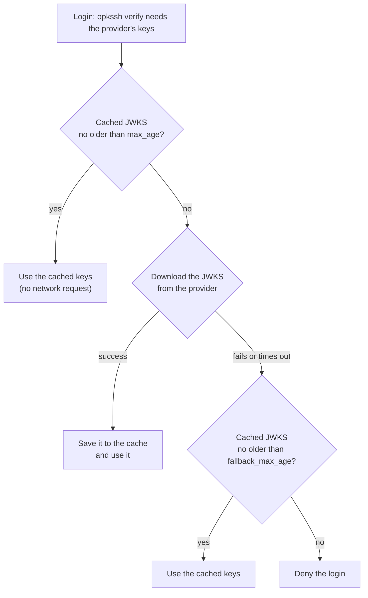
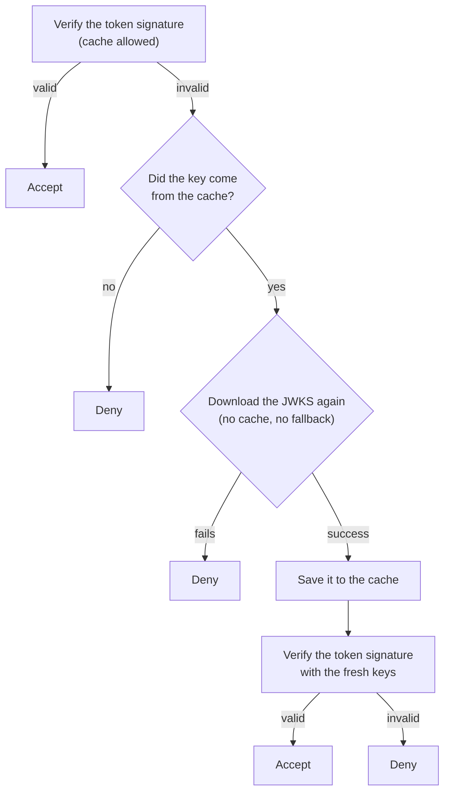
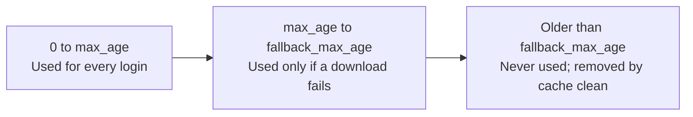
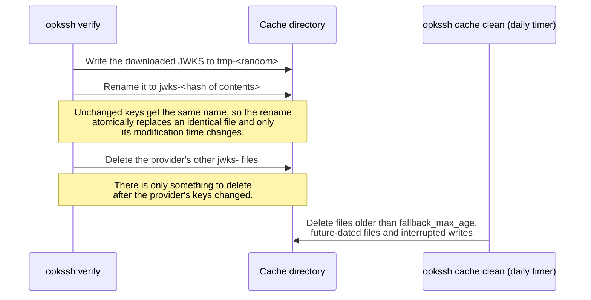

# JWKS cache

`opkssh verify` checks each login's ID token against the provider's public signing keys, its JWKS. sshd starts a new `opkssh verify` process for every login, so by default every login downloads the JWKS from the provider.

The persistent JWKS cache saves the JWKS on disk, so that:

- most logins don't contact the provider, which makes them faster and reduces load on the provider, and
- logins keep working for a while if the provider can't be reached.

The cache is off by default, including after upgrading opkssh: nothing changes until you enable it. It is supported on Linux and macOS, not on Windows.

## Enabling the cache

The easiest way is to let the installer set it up:

```bash
OPKSSH_INSTALL_CACHE_DIR=/var/cache/opkssh ./install-linux.sh
```

The installer:

1. creates the directory, owned by the `AuthorizedKeysCommandUser` account (`opksshuser` by default) with mode `0700`,
2. on SELinux systems, labels it `opkssh_cache_t` (see [SELinux](#selinux)),
3. runs `opkssh cache check` as that account against a copy of `config.yml` with the new `cache` section,
4. only if the check passes, adds the `cache` section to `/etc/opk/config.yml`,
5. installs and enables a daily `opkssh-cache-clean.timer`. If systemd isn't running, for example while building a container image, the timer is enabled to start on the next boot.

The installer does this for whatever directory you set; `/var/cache/opkssh` is only the conventional choice. The directory must not exist yet, be empty, or already hold an opkssh cache: the installer re-owns and relabels the whole directory, so it refuses one that contains anything else (for example `/var/cache` itself).

To use another account, set `OPKSSH_INSTALL_AUTH_CMD_USER` and `OPKSSH_INSTALL_AUTH_CMD_GROUP`. To change the cleanup schedule, set `OPKSSH_INSTALL_CACHE_CLEAN_ON_CALENDAR` to a systemd `OnCalendar` expression.

If you enable the cache any other way, by editing `config.yml` or with `opkssh verify --cache=on`, nothing creates or labels the directory for you. Create it with the ownership and mode above, label it if SELinux is enabled (see [SELinux](#selinux)), add the `cache` section below to `/etc/opk/config.yml`, and schedule `opkssh cache clean` to run as the verify account. Then run the preflight:

```bash
sudo -u opksshuser opkssh cache check
```

## Settings

```yml
cache:
  base_dir: /var/cache/opkssh
  max_age: 1h
  fallback_max_age: 2h
```

| Setting | Default | Meaning |
|---|---|---|
| `base_dir` | none, cache off | Directory for the cache. Setting it turns the cache on. |
| `max_age` | `1h` | How long a downloaded JWKS is used before opkssh downloads it again. |
| `fallback_max_age` | twice `max_age` | When a download fails, how old a cached JWKS may be and still be used. Set it equal to `max_age` to turn the fallback off. |

`max_age` and `fallback_max_age` are Go durations such as `90m` or `1h30m`. There's no day unit; write `24h`. `max_age: 0` means the default, not "no caching". `fallback_max_age` must be at least `max_age`.

`base_dir` must:

- be an absolute path,
- be owned by the `AuthorizedKeysCommandUser` account, including when that account is `root`,
- not be writable by group or others,
- have parent directories that are owned by `root` and not writable by group or others, as `/var/cache` is by default. opkssh doesn't check the parents; a user who can write to one could replace `base_dir`,
- be labelled `opkssh_cache_t` when SELinux is enabled.

If any of these checks fail, `opkssh verify` logs why, turns the cache off and verifies with freshly downloaded keys. A cache problem never blocks a login.

## How a login uses the cache

Every login looks up the provider's keys like this. The cache covers OpenID Connect providers, GitHub Actions, Forgejo Actions and GitLab CI.



Every request to a provider times out after 10 seconds, so the fallback is reached well within sshd's default `LoginGraceTime` of 120 seconds. sshd usually runs `opkssh verify` twice per login: once when the client offers the key and once for the signed attempt. So a login that falls back because the provider isn't responding can take about 20 seconds.

If the cache is off, every login takes the "Download" path, and a failed download denies the login.

### When the provider rotates its keys

A token signed with a key the provider added after the JWKS was cached won't verify against the cached copy. opkssh then tries once more, bypassing the cache:



So only the first login after a rotation pays for an extra download. The retry never falls back to old keys.

### How old a cached JWKS can be



A cached JWKS with a modification time in the future is never used, since that can only come from clock changes or tampering.

## What's on disk

```text
/var/cache/opkssh/                         owned by the verify account, 0700
└── <sha256 of the issuer URL>/
    └── jwks/
        ├── jwks-<sha256 of the JWKS>      the cached JWKS, mode 0640
        └── tmp-<random>                   a write in progress
```

Each file is named after a hash of its contents, and its modification time is when that JWKS was last downloaded. This is how writes and cleanup work:



Because unchanged keys keep the same file name, a login reading the cache never finds its file missing, however often other logins download the JWKS. A login can only miss a file at the moment the provider's keys change; it then downloads the JWKS itself.

`opkssh cache clean` removes left-over files older than `fallback_max_age`, or older than the duration you pass it (`opkssh cache clean 24h`). It also removes future-dated files and interrupted writes, and, once they are old enough, the files of providers you've removed. It exits successfully when no cache is configured, so it's safe to schedule everywhere.

## Debugging

`opkssh verify` logs which cache mode it is using to `/var/log/opkssh.log`, for example:

```text
Persistent JWKS cache on (--cache=auto): /var/cache/opkssh, max_age 1h0m0s, fallback_max_age 2h0m0s
```

It also logs the two events that matter when a provider is down or the cache stays empty: a login served from the fallback window, and a JWKS that could not be written (for example because the directory is missing or the verify account can't write to it):

```text
Using fallback JWKS from cache for https://accounts.google.com, fetched 1h30m0s ago: the provider could not be reached or served no usable keys
Failed to write JWKS cache for https://accounts.google.com: mkdir /var/cache/opkssh: permission denied
```

To rule the cache in or out, override `config.yml` with the `--cache` flag of `opkssh verify`, for example in the `AuthorizedKeysCommand` line of your sshd configuration:

```text
AuthorizedKeysCommand /usr/local/bin/opkssh verify --cache=off %u %k %t
```

| `--cache` | Effect |
|---|---|
| `auto` (default) | Use the `cache` section of `config.yml`. |
| `off` | Don't use the cache, whatever `config.yml` says. |
| `on` | Use the cache even if `config.yml` has no `cache` section, with `/var/cache/opkssh` and the default ages unless `config.yml` sets them. The `base_dir` checks above still apply. The directory must already exist; see [Enabling the cache](#enabling-the-cache). |

`opkssh cache check`, run as the verify account, reports any problem with the cache directory or the server configuration.

## SELinux

On SELinux systems, `opkssh verify` runs in sshd's SELinux domain. The opkssh policy module (`opkssh.te`) lets that domain create, read, rename and delete files only in directories labelled `opkssh_cache_t`. The installer labels `base_dir` for you; it needs `semanage`, from the `policycoreutils-python-utils` package on RHEL, CentOS and Fedora. To label a directory by hand:

```bash
sudo semanage fcontext -a -t opkssh_cache_t '/var/cache/opkssh(/.*)?'
sudo restorecon -R /var/cache/opkssh
```

If the label is missing, `opkssh verify` logs an error with these commands and runs without the cache.

The installer can only label the directory if the opkssh SELinux policy it installs defines `opkssh_cache_t`. Policies published before the JWKS cache don't. When you install a local build with `--install-from`, also pass `--install-te-from` with the `opkssh.te` from the same build; otherwise the installer stops with an error naming the policy it found.

## Proxies

Requests to providers use the proxy you set with `env_vars` in `config.yml` (`HTTPS_PROXY`, `NO_PROXY`), with or without the cache. The 10-second timeout includes the time spent talking to the proxy. If `config.yml` can't be loaded, `env_vars` isn't applied and downloads go direct, as they would without the cache.

## Security considerations

- **The verify account is trusted with signing keys.** Anyone who can run code as the `AuthorizedKeysCommandUser` account can write a JWKS containing their own key to the cache. They can then forge ID tokens for any configured provider and log in as any principal the policy allows, until that JWKS is older than `max_age`. Don't use an account that runs anything other than `opkssh verify`.
- **Revoked provider keys stay trusted for a while.** When a provider removes a key from its JWKS, servers keep accepting it until their cached copy is older than `max_age`. Someone who can also stop the server from reaching the provider can extend this to `fallback_max_age`. A shorter `max_age` picks up key changes sooner; a longer one improves availability.
- **Avoid a very large `fallback_max_age`.** It has no upper limit, and a large value lets old provider keys be trusted long after the provider replaced them. It is not a substitute for a break-glass account. sshd checks `AuthorizedKeysFile` before it runs opkssh, so a static emergency key in an `authorized_keys` file works whatever the state of the cache; connect with `ssh -o IdentitiesOnly=yes -i <key>` so that only that key is offered.
- Nobody can add a key to the cache through a login: opkssh only caches what it downloads over HTTPS from the issuer configured in `/etc/opk/providers`.
